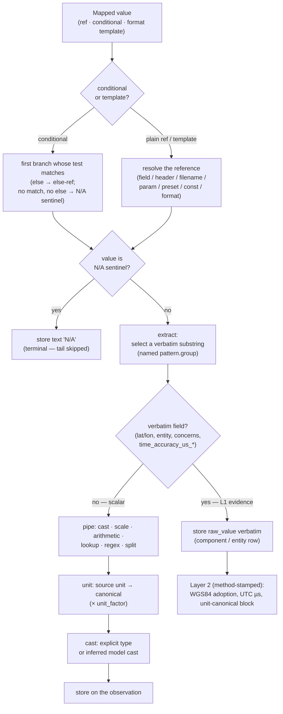

# Preset Authoring Guide (v3)

This guide teaches how to turn one real source — a CSV or Excel export, a SQLite table,
or a Cellebrite XML report — into a working mATLAS preset. It explains the mental model,
walks three complete presets, and collects the edge cases that trip authors up. For the
exhaustive list of every admitted key, reference kind, pipe transform and vocabulary, use
the companion [Preset YAML Schema Reference](preset_schema.md); for the data model the
mappings feed, see the [run database schema](../model/schema.md).

## 1. The mental model

A preset is a **declaration**, not a script. It states three things:

1. **which source** it targets (`input_selector`),
2. **what fields the source has** (`expected_fields`), and
3. **how each source value maps** to the canonical model (`common` + `observations`).

The golden rule is **the source's words, verbatim, at Layer 1**. A preset never converts:
it selects a value, optionally selects a substring of it, and declares how to decode a
timestamp or which canonical unit a number is in. The actual unit conversion, timezone
resolution and datum adoption are method-stamped Layer-2 interpretations the engine
performs afterwards — never the preset. This is why a coordinate is mapped to the
datum-agnostic `latitude` / `longitude` parts and the datum is stated *separately*.

An observation is the unit of output: **one entity, in one role, at one place expression,
over one time expression, bound by three links**. One source record can fan out into
several observations (a trip → a start and an end), and several presets can read one record.

### How one value resolves

Every mapped value is one reference call, a conditional chain over such calls, or a
mapping that adds attributes. The engine resolves it along a fixed tail. Verbatim fields
(coordinates, the entity/concerns text, per-bound time accuracy) stop after `extract`;
scalar fields (links, roles, `deleted`, kinds, units) run the full tail.



## 2. Step by step

### 2.1 Write the header

`id` is a stable dotted key; `tool` is the forensic tool for a tool export and empty for a
raw device source; together with `os` / `name` it composes the title.

```yaml
preset:
  id: ios.routined.cached_locations
  name: Routined Cached Locations
  os: iOS
  tool:                 # empty -> primary (device's own DB); set "AXIOM" etc. for exports
  os_version: ">=13"
  version: 1.0
  tier: primary
```

### 2.2 Identify the source (`input_selector`)

Use `name:` for the easy basename case (it fans out to every matching file). Use `path:`
when location is the discriminator — an anchored, prefix-tolerant path that matches a loose
folder tree and a full-filesystem ZIP alike, with `{uuid}` and `*` for variable segments.
`format` is always magic-verified. Pass a **list** of selectors for OR alternatives.

```yaml
input_selector:         # SQLite — anchored device path (folder or ZIP, prefix-tolerant)
  format: sqlite
  path: /private/var/mobile/Library/Caches/com.apple.routined/Cache.sqlite
  table: ZRTCLLOCATIONMO
```

```yaml
input_selector:         # CSV — basename match anywhere (a tool export)
  format: csv
  name: "Cached Locations.csv"
  encoding: "utf-8-sig"
```

See the reference [§4](preset_schema.md#4-input_selector) for every per-format reader key
(sqlite `table`/`sql`, excel `sheet`, xml `model`/`namespace`, csv read options) and the
same-role-OR / different-role-AND rule.

### 2.3 Declare the fields you have (`expected_fields`)

List every source field up front, then map the subset you need. The unmapped ones become
the research frontier (reported in the warnings sidecar); the inventory drives drift
detection and preset tie-breaking. Entries may be exact names or globs.

```yaml
expected_fields:
  - ZLATITUDE
  - ZLONGITUDE
  - ZTIMESTAMP
  - ZSPEED
  - "Timestamp Date/Time - * (dd.MM.yyyy)"   # a glob is fine
```

### 2.4 Share fields with `common`

Fields every observation needs go in `common:` once. A `common:` coordinate becomes the
record's base place, shared by each observation.

```yaml
common:
  entity:          param(entity)        # or a source field; or pass --entity at run time
  entity_type:     const(device)
  source_label:    const(ZRTCLLOCATIONMO)
  position_source: const(GNSS)
  raw_source_path: preset(path)         # the device path this preset targets
```

### 2.5 Map an observation

```yaml
observations:
  - position:
      latitude:  field(ZLATITUDE)             # datum-agnostic L1 part; numeric cast inferred
      longitude: field(ZLONGITUDE)
      spatial_referential: const(epsg:4326)   # the datum — required for the coords to integrate
      altitude_m:      { from: field(ZALTITUDE), unit: m }        # metric field: unit: required
      horizontal_speed_kmh: { from: field(ZSPEED), unit: m/s }   # source m/s -> canonical km/h
    time:
      instant: field(ZTIMESTAMP)
      epoch:   cocoa
      zone:    const(UTC)
    links:
      entity_position:  at
      entity_time:      observed_at
      spatial_temporal: instant
```

For two times at one place (a visit interval and a created instant), write two observation
entries; they share the record's UID automatically.

## 3. Worked example — iOS SQLite (primary source)

A device's own Core Data cache, located by its anchored path. Coordinates plus a Cocoa-epoch
instant; speeds arrive in m/s and are declared as such.

```yaml
preset:
  id: ios.routined.cached_locations
  name: Routined Cached Locations (CLLocation)
  os: iOS
  tool:                       # empty: primary source (the device's own database)
  os_version: ">=13"
  version: 1.0
  tier: primary

input_selector:
  format: sqlite
  path: /private/var/mobile/Library/Caches/com.apple.routined/Cache.sqlite
  table: ZRTCLLOCATIONMO

expected_fields:
  - Z_PK
  - ZALTITUDE
  - ZCOURSE
  - ZHORIZONTALACCURACY
  - ZLATITUDE
  - ZLONGITUDE
  - ZSPEED
  - ZSPEEDACCURACY
  - ZTIMESTAMP
  - ZVERTICALACCURACY

# source_record_uid omitted: the rowid (Z_PK) is not a stable UID, so a deterministic,
# content-addressed UID is generated per row instead.

common:
  entity:          param(entity)
  entity_type:     const(device)
  source_label:    const(ZRTCLLOCATIONMO)
  position_source: const(GNSS)
  raw_source_path: preset(path)   # device db path; input_record_id defaults to <table>#<ordinal>

observations:
  - position:
      latitude:                       field(ZLATITUDE)
      longitude:                      field(ZLONGITUDE)
      spatial_referential:            const(epsg:4326)   # the datum for the coordinates
      altitude_m:                     { from: field(ZALTITUDE), unit: m }
      horizontal_accuracy_m:          { from: field(ZHORIZONTALACCURACY), unit: m }
      vertical_accuracy_m:            { from: field(ZVERTICALACCURACY), unit: m }
      heading_deg:                    { from: field(ZCOURSE), unit: deg }
      horizontal_speed_kmh:           { from: field(ZSPEED), unit: m/s }
      horizontal_speed_accuracy_kmh:  { from: field(ZSPEEDACCURACY), unit: m/s }
    time:
      instant: field(ZTIMESTAMP)   # Cocoa/Core-Data epoch -> Unix us
      epoch:   cocoa
      zone:    const(UTC)
    links:
      entity_position:  at
      entity_time:      observed_at
      spatial_temporal: instant
```

This is based on the mATLAS-presets `ios/ios_routined_cached_locations.yaml` (its
`expected_fields` inventory is trimmed here for brevity).

## 4. Worked example — CSV tool export (secondary source)

An AXIOM CSV export located by basename. Two features a device DB does not need: a genuine
source UID (`Item ID`) is mapped so output rows link back to the tool artefact; and the
export timezone is embedded in the timestamp header and captured from it.

```yaml
preset:
  id: ios.axiom.cached_locations
  name: Cached Locations
  os: iOS
  tool: AXIOM
  version: 1.0
  tier: secondary

input_selector:
  format: csv
  name: "Cached Locations.csv"
  delimiter: ","
  encoding: "utf-8-sig"

expected_fields:
  - Record
  - Latitude
  - Longitude
  - "Accuracy (m)"
  - "Altitude (m)"
  - "Altitude Accuracy (m)"
  - Direction
  - "Speed (m/s)"
  - "Timestamp Date/Time - UTC+00:00 (dd.MM.yyyy)"
  - Source
  - Location
  - "Recovery method"
  - "Item ID"

patterns:
  tz: "(?P<z>UTC[+-]\\d{2}:\\d{2}(?:\\[DST\\])?)"   # the export timezone embedded in the header
lookup_tables:
  recovery: {Parsing: intact, Carving: recovered, Deleted: deleted}

source_record_uid: 'field("Item ID")'   # a real tool UID -> map it verbatim

common:
  entity:          param(entity)
  entity_type:     const(device)
  source_label:    const(ZRTCLLOCATIONMO)
  position_source: const(GNSS)
  input_record_id: field(Location)
  raw_source_path: field(Source)
  deleted: { from: 'field("Recovery method")', pipe: "lookup(recovery, on_unknown=null)" }

observations:
  - position:
      latitude:              field(Latitude)
      longitude:             field(Longitude)
      spatial_referential:   const(epsg:4326)   # the datum for the coordinates
      altitude_m:            { from: 'field("Altitude (m)")', unit: m }
      horizontal_accuracy_m: { from: 'field("Accuracy (m)")', unit: m }
      vertical_accuracy_m:   { from: 'field("Altitude Accuracy (m)")', unit: m }
      heading_deg:           { from: field(Direction), unit: deg }
      horizontal_speed_kmh:  { from: 'field("Speed (m/s)")', unit: m/s }
    time:
      # The header embeds the export timezone; capture it with header() + regex and it is
      # applied to parsing automatically.
      instant: 'field("Timestamp Date/Time - * (dd.MM.yyyy)")'
      format:  "%d.%m.%Y %H:%M:%S.%f"
      zone:    { from: 'header("Timestamp Date/Time - * (dd.MM.yyyy)")', pipe: "regex(tz, group=z)" }
    links:
      entity_position:  at
      entity_time:      observed_at
      spatial_temporal: instant
```

This is based on the mATLAS-presets `axiom/ios_cached_locations.yaml` (its
`expected_fields` inventory is trimmed here for brevity). Note the field names with
spaces are quoted (`'field("Item ID")'`), and the glob `* (dd.MM.yyyy)` matches the header
whatever timezone it carries.

## 5. Worked example — an interval (a visit)

A dwell window uses `interval:` with a `lower` and `upper` bound and the
`continuous_during_interval` spatial-temporal link. Both bounds share the one `epoch` and
`zone` declaration.

```yaml
observations:
  - position:
      latitude:              field(ZLOCATIONLATITUDE)
      longitude:             field(ZLOCATIONLONGITUDE)
      spatial_referential:   const(epsg:4326)
      horizontal_accuracy_m: { from: field(ZLOCATIONHORIZONTALUNCERTAINTY), unit: m }
      position_type:         const(visit)          # the place's role -> spatial_role
    time:
      interval:                                    # the dwell window (Cocoa epoch -> us)
        lower: field(ZENTRYDATE)
        upper: field(ZEXITDATE)
      epoch: cocoa
      zone:  const(UTC)
    links:
      entity_position:  at
      entity_time:      observed_at
      spatial_temporal: continuous_during_interval
```

Adapted from the mATLAS-presets `ios/ios_routined_significant_visits.yaml`.

## 5b. Worked example — start + duration (a CDR)

A telecom operator discloses when a call started and how long it lasted — never when it
ended. State the span with `duration_sec:` instead of `upper:` and the engine derives the end.

```yaml
source_record_uid: default          # the export has no stable key: say so, don't just omit

common:
  entity:          field(CDRInfo)
  entity_type:     const(device)
  raw_source_path: field(SourceFile)
  activity_kind:   const(observation)   # REQUIRED for the context entry below to exist
  context.antenna: format("{field(GlobalCellID)}")

observations:
  - position:
      latitude:            field(Latitude)
      longitude:           field(Longitude)
      spatial_referential: const(epsg:4326)
      beam_azimuth_deg:    { from: field(Beam), unit: deg }
      # A zero-length event happened at an instant; anything else spans the call. This has to
      # be the full column name — the `links:` block below takes bare enum tokens only.
      spatial_temporal_link: if field(Duration) == 0 then const(instant)
                             else const(once_during_interval)
    time:
      interval:
        lower:        field(TimeStamp)
        duration_sec: { from: field(Duration), unit: s }
      format:              "%Y-%m-%d %H:%M:%S"
      zone:                const(Europe/Zurich)   # the source's OWN zone, DST-resolved
      temporal_role_lower: const(start)
      temporal_role_upper: const(end)
    links:
      entity_position: within_range_of
      entity_time:     recorded_at
```

Three things worth copying:

- **`duration_sec` keeps L1 verbatim.** The component stores the operator's own `"187"` under
  the part `duration`; the end bound is derived at L2 and stamped
  `…+start_plus_duration/1.0`. The `unit:` says what the digits mean, it never rewrites them.
- **Name the zone, don't state an offset.** `const(+01:00)` would be applied season-blind and
  put every summer call an hour out; `const(Europe/Zurich)` resolves each bound's own offset.
- **`activity_kind` is what creates the activity.** Without it in `common:`, the
  `context.<key>` entries are resolved and then discarded — a silent loss the linter now warns
  about.

From the mATLAS-presets `CDR/cdr_fulldata_csv.yaml`.

## 6. Timestamps

A `time:` block decodes to Unix microseconds. Pick exactly one decoding:

```yaml
time: {instant: field(TS), format: "%d.%m.%Y %H:%M:%S.%f"}   # a formatted string
time: {instant: field(TS), format: iso8601}                  # ISO-8601 (keeps a stated offset)
time: {instant: field(TS), epoch: unix_ms}                   # epoch milliseconds
time: {instant: field(TS), epoch: cocoa, zone: const(UTC)}   # Apple Cocoa (2001) epoch
```

For a non-UTC export whose zone lives in the column header, capture it and it is applied to
parsing (see the CSV example above). The `zone:` value is a `const(...)` or a `header(...)`
field-spec.

See the reference [§11](preset_schema.md#11-time) for the full grammar and the two silent
assumptions (no decoding → Unix µs; no zone → UTC with a loud ` N/A`), which are also
covered under Edge cases below.

## 7. Pipes, tables and patterns (only when needed)

Declarative attributes (`type`, `unit`, `epoch`, `extract`) cover most cases; drop to a
`pipe:` only for real logic. Bulk data lives in `lookup_tables` / `patterns` and is
referenced by name.

```yaml
lookup_tables: {recovery: {Parsing: intact, Carving: recovered, Deleted: deleted}}
patterns:      {coords: "(?P<lat>-?\\d+\\.\\d+) - (?P<lon>-?\\d+\\.\\d+)"}
...
  deleted: { from: 'field("Recovery method")', pipe: "lookup(recovery, on_unknown=null)" }
  # one cell holding "lat - lon": pull each named group into its own field
  latitude:  { from: field(Coords), extract: coords.lat }
  longitude: { from: field(Coords), extract: coords.lon }
  spatial_referential: const(epsg:4326)   # the datum for the coordinates above
```

`regex` and `extract` both require **named** groups, and you name which group to pull — so
what is extracted is explicit. The full transform list, argument shapes and `on_error` /
`on_unknown` policies are in the reference [§10](preset_schema.md#10-pipes).

## 8. Conditional values and composed text

When a field's meaning depends on another field, map it as an `if / elif / else` chain —
first match wins:

```yaml
common:
  spatial_temporal_link: if field(ExitTime) == "NA" then const(instant)
                         elif field(Confirmed) == "1" then const(continuous_during_interval)
                         else const(once_during_interval)
```

To build one value from several fields plus literal text, use a `format(...)` template:

```yaml
common:
  source_label: format("{field(FirstName)} {field(LastName)} from {field(City)}")
```

The comparand `"NA"` is the explicit missing-value test; `{{` / `}}` write a literal
brace; a template also works as a conditional branch result (`… then format(…)`). The
precise semantics — the `N/A` sentinel, integral-float matching, empty-placeholder
rendering — are in the reference [§8.3](preset_schema.md#83-conditional-values-if--elif--else)
and [§8.4](preset_schema.md#84-templates-format), and the traps are listed below.

## 9. Edge cases

These behaviours are deliberate but easy to get wrong. Each is enforced by the code cited.

### Selectors: same-role OR, different-role AND

A **list** of selectors sharing the same (or default) `role` are **OR** alternatives — one
preset, two formats or two tables — and the first to match wins:

```yaml
input_selector:
  - { format: sqlite, path: /.../Local.sqlite,  table: ZVISITMO }
  - { format: sqlite, path: /.../Cloud.sqlite,  table: ZVISITMO }   # same role -> OR
```

Selectors with **distinct** roles are **AND** (every role must resolve) and require the
deferred ScriptExtractor — running one now raises `NotImplementedError`.

### `optional: true` — mapped but absent

Marking a field `optional: true` means a mapped-but-absent source column yields a **null
cell** instead of failing the match. Use it for enrichments a schema version may omit:

```yaml
altitude_m: { from: field(Position.Elevation), unit: m, optional: true }
```

Without `optional`, a **required** match field that is absent disqualifies the preset for
that file (the engine prefers a preset whose mapped fields actually fit).

### Glob field / header names

`field(...)` and `header(...)` names may be globs (`*`), which is how a header carrying a
variable timezone is matched (`"Timestamp - * (dd.MM.yyyy)"`). A glob must resolve to
exactly one source field. Quote a name that contains spaces.

### The `const(epsg:4326)` requirement

The datum must be a **call form**. A bare `spatial_referential: epsg:4326` fails the
reference parser — write `spatial_referential: const(epsg:4326)`.

### Missing referential → unknown + warning + empty coordinates

If you map `latitude` / `longitude` but state **no** `spatial_referential`, the spatial
expression resolves to `unknown`, the coordinates are **not** integrated, and a warning is
surfaced (`_spatial_referential` in `ingest/assemble.py`). The datum is never inferred from
the presence of an angle part.

### `unit:` is required on every metric field

Every metric field (any `CANONICAL_UNIT` key: `altitude_m`, the accuracy, speed, heading and
beam parts) **must** declare its source `unit:`. Map one with no `unit:` and the loader
**raises** a `ValueError` — it will not guess. This closes a silent trap: a bare mapping's unit
would otherwise be assumed canonical, so a source value in m/s mapped to `horizontal_speed_kmh`
without `unit: m/s` would be stored as if it were already km/h (a silent 3.6× error). Declare
the real source unit (`unit: m/s`), or, when the source already is canonical, confirm it
explicitly with `unit: <canonical>` (`unit: m` on `altitude_m`, `unit: deg` on `heading_deg`) —
the intent is now stated, not assumed. `latitude` / `longitude` are **not** metric (they are
angles adopted via `spatial_referential`) and need no `unit:`. Reference
[§10.2](preset_schema.md#102-unit-conversion) lists the canonical units and factors.

### `time:` with no epoch/format → assumed Unix µs

A `time:` block with neither `epoch` nor `format` assumes the value is **already Unix
microseconds**. Map `epoch`/`format` unless the source truly stores µs.

### No zone → assumed UTC, flagged loudly

A `time:` block with no `zone` assumes **UTC** and marks the assumption with a trailing
` N/A` on the materialised local datetime (`UTC_OFFSET_UNKNOWN`). The instant is still
recorded; the flag tells the examiner the offset was assumed, not stated.

### A named zone beats a fixed offset, and beats the configured one

`zone: const(Europe/Zurich)` resolves each bound's own offset through the tz database, so an
interval spanning a DST change gets two different applied offsets. `zone: const(+01:00)` is
season-blind by design — the source declared that number, so it is applied verbatim all year.
A named zone also **outranks** the operator's configured `[timezone].local_zone`: the preset
states what this source's clocks mean, the config only says what to assume otherwise.

A zone name the tz database does not know is rejected at **load**, because at conversion time
it would not fail — it would quietly fall back to assuming UTC.

### `name:` is an exact basename, never a glob

`input_selector.name` matches by exact basename equality. A wildcard (`name: "*AllData.csv"`)
matches nothing, so the preset loads cleanly and then never fires. Use the exact name, or
`path:` for an anchored path with `{uuid}` / `*` segments. The linter flags this.

### The `N/A` sentinel vs an empty cell

A conditional with no matching branch and no `else`, or a template whose every placeholder
is missing, yields the **`N/A` sentinel** — stored as the text `N/A`. This is **distinct**
from an unmapped field, which is NULL. `N/A` means "the mapping ran and produced nothing";
NULL means "never mapped". Keep the two straight when reading output.

### Lookup key collision → hard error

A `lookup_tables` entry that declares keys colliding after normalisation (both `1:` and
`"1":`) raises a `TransformHardError` at run time rather than letting one silently win.
Remove the ambiguous duplicate.

### The bool-cast spelling rule

`cast(bool)` (and `type: bool`) reads **recognised spellings**, not Python truthiness:
true = `1/true/yes/y/t`, false = `0/false/no/n/f/""` (case-insensitive). An unrecognised
token raises. This is why `bool("false")` — which Python evaluates to `True` — cannot
silently invert a source value here.

### Typo'd conditional comparand → parse error

A conditional comparand that looks like a call but names an unknown kind (`feild(Y)`)
**raises at parse time** rather than degrading to an unmatchable string that would silently
send every row down the `else` branch. Quote a genuine literal (`"foo(bar)"`).

## 10. Run it

`--concerns` is required; `--entity` is optional. A single input file plus a single preset
YAML runs in **force-preset mode** (selector matching bypassed), which is handy while
iterating:

```bash
python matlas.py process \
  --input ./evidence/Cache.sqlite \
  --presets ../presets/mATLAS-presets/ios/ios_routined_cached_locations.yaml \
  --output ./out/routined.csv \
  --concerns "Case Subject"
```

Inspect `out/routined.csv` plus the `.matlas.traceability.json` and
`.matlas.warnings.json` sidecars; the warnings sidecar lists unmapped columns (the research
frontier) and any surfaced assumptions (a missing referential, an assumed zone).

## 11. Lint your preset

Before relying on a preset, lint it for errors, likely mistakes and best-practice nudges:

```bash
python utils/lint_presets.py ../presets/mATLAS-presets/ios/ios_routined_cached_locations.yaml --advice
```

It reports ERRORs (won't load), WARNINGs (e.g. a half-coordinate, a missing link, a rowid
mapped as `source_record_uid`) and ADVICE (naming, tier/tool coherence, a naive timezone,
raw epoch arithmetic).

Findings carry a **suggestion** — the YAML to write instead, printed as a `→ fix:` line:

```
WARNING glob-in-selector-name: selector name '*AllData.csv' contains wildcards, but 'name'
        is matched as an EXACT basename — this preset will never match a file
        → fix: name: AllData.csv
```

Two groups are worth knowing about:

- **Checks that run before parsing.** A preset that does not load still gets diagnosed, since
  the parser stops at the first problem: a model field written at the top level instead of
  under `common:`, an unknown top-level key, a conditional under `links:`, a glob in `name:`.
- **Checks for silent degradation** — the preset loads and then quietly does less than it
  looks like it does: a `const` on a free-text controlled column (`entity_type`,
  `identifier_type`, `position_type`, `spatial_referential`) that no vocabulary recognises,
  coordinates with no `spatial_referential`, `context.<key>` with no `activity_kind`, a fixed
  offset where a zone name belongs, a `duration_sec` whose declared unit contradicts its
  column name.

The same checks are available as a library:

```python
from model_atlas.presets import lint_file, lint_paths   # -> list[LintFinding]
```

`--strict` makes warnings fail the run (useful in CI); the default exit code is non-zero
only on errors.

## 12. Different OS versions

If a later OS renames columns, copy the preset to a new file, set its `os_version` range,
and adjust the changed column names. The engine auto-selects the preset whose mapped columns
actually fit the source by structural fit — you do not choose by hand.
