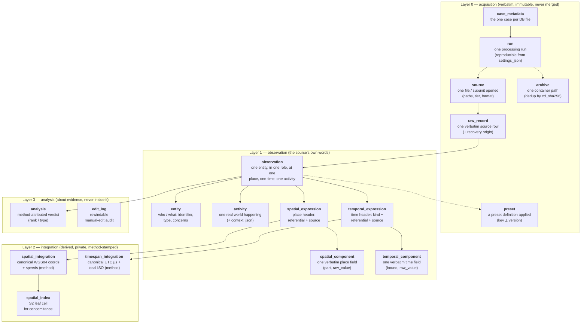

# Run database schema — the settled shape

This is the implementation shape of [conceptual_model.md](conceptual_model.md); the editable ER
diagram is [matlas_run_db.xml](matlas_run_db.xml) (open at <https://sql.toad.cz/>) and the
identity discipline is [identity_model.md](identity_model.md). Design priority: **fidelity to
reality, not performance — and only what is really needed.** [entity_model.md](entity_model.md)
describes the **deferred** analyst layer, not the run schema.

SQLite, **temp on-disk** during the run (`journal_mode=OFF`, `synchronous=OFF` — the
run DB is reproducible scratch), persisted via `VACUUM INTO` (this removes the
old backup-deadlock constraint). `PRAGMA foreign_keys = ON`. `core/vocabularies.py` stays the
single declaration of every vocabulary; `schema.py` derives DDL and CHECKs
one-directionally.

## The model in one paragraph

A **Raw Record** (verbatim, inside a **Source**, inside a **Run**) yields
**Observations**. An observation is one entity, in one role, within one **Activity**, at
one place expression, at one time expression — qualified by the link vocabularies.
The two corners follow one pattern: an **expression** stores the source's own words
(header + component rows); an **integration** stores the derived canonical form
(1:1, private, method-stamped). The **entity** is one lean row: a normalized
identifier, the normalization that produced it, what it is, and whom it concerns.
Sameness — of entities, places, times, or activities across sources — is a query
(GROUP BY the normalized identifier / canonical values) or an explicit analysis act,
never an ingest-time merge. Everything analyst-graph-shaped (person chains, validity
intervals, mention resolution, cross-record activity linking) is **deferred out of
v1** — designed in entity_model.md, absent from the run schema.

## Visual overview

A simplified map of the tables by layer and their purpose (keys and columns omitted — see the
tables below for those). Solid arrows are the ownership/foreign-key spine; the pure link tables
(`run_archive`, `run_preset`, `activity_record`) and `matlas_meta` are omitted for clarity.

The two corners share one pattern: an **expression** (L1) holds the source's own words as a header
plus verbatim component rows; a 1:1 **integration** (L2) holds the derived canonical form,
method-stamped. The flat CSV is a projection over this spine.

## Tables (by layer)

### Layer 0 — acquisition (verbatim, immutable, never merged)

| table | columns | keys / notes |
| --- | --- | --- |
| case_metadata | case_id, case_number, title, description, created_at, created_by | **The root** — uuid4 PK; exactly ONE row per run-DB file (one case per database). `case_number` is the user-facing identifier. Hierarchy: case → run → source → raw_record → observation. Physical name `case_metadata` (owner ruling 2026-07-14: `CASE` is an SQL keyword; columns keep the `case_` prefix) |
| run | run_id, case_id FK NOT NULL, input_path, started_at, finished_at, tool_version, settings_json, examiner | PK run_id (**uuid4** — the only non-deterministic id; feeds no child id); `case_id` FK; input_path = the operator's `--input` root; **settings_json is normatively COMPLETE**: every operator argument and option, canonical JSON — the run is reproducible from its row; selected presets via `run_preset`; examiner optional |
| matlas_meta | schema_version, families_version (one row) + `PRAGMA user_version` + SQLite `application_id` | versioning and the self-ingestion stamp: discovery refuses/flags stamped artefacts |
| model_description | table_name, field_name, type, unit, matlas_enrichment, description | **The DB describes itself.** One row per TABLE (`field_name` NULL, explaining its purpose) and one per FIELD, `UNIQUE(table_name, field_name)`. Every column is DERIVED — `type` from the same `_sql_type` the DDL uses, `unit` read back from the field's own naming convention (`altitude_m`, `heading_deg`, `lower_accuracy_us`), `matlas_enrichment` from the field's marker, `description` from `vocabularies.DESCRIPTIONS` — so the description can never disagree with the schema it describes. **This is the source of truth for which columns mATLAS ADDED rather than read from the trace**: SQLite has no structured column attribute (`PRAGMA table_info` returns name/type/notnull/default/pk and nothing else), so a described row is the only way a persisted run DB can carry that fact. `core/flat_view.py` derives the `_matlas` column suffix from the same marker. Physical names `table_name`/`field_name` because `table` is an SQL keyword — the same reason `case` became `case_metadata` |
| archive | archive_id, path, cd_sha256 | **One row per container path** — id from the **path only**, UNIQUE(path), `cd_sha256` a plain INDEXED column. "Same archive bytes twice" (two identical-bytes exhibits, or across runs) is a **query/finding** (`GROUP BY cd_sha256`). `cd_sha256` **reuses `model_atlas/sqlite/integrity.py` (`fingerprint_zip` / `zip_resume_key`)** — no new hashing |
| run_archive | run_archive_id, run_id FK, archive_id FK, parsed_at, skipped | **The run↔archive link**: one run opens many archives, one archive may appear in many runs — UNIQUE(run_id, archive_id). EVERY encounter is recorded, including an **opt-in skip** (`skipped=1`, never traceless): re-walking may be skipped only when the operator opted in (recorded in settings_json) AND a previous run parsed the same `cd_sha256` with the same preset set (key + version + definition_digest) |
| run_preset | run_preset_id, run_id FK, preset_id FK | **The run↔preset link**: every preset SELECTED for the run (reusing the preset table), recorded even when a preset yields no observation. UNIQUE(run_id, preset_id) |
| source_file | source_file_id, run_id FK, input_file_path, inner_path, reported_data_source, format, subunit, fingerprint_sha256, sibling_fingerprints_json, exhibit_ref, source_tier, record_count | UNIQUE(run_id, input_file_path, inner_path, subunit); INDEX fingerprint_sha256 — the id derives from **paths, never the fingerprint**. **Preset-free**: a source is *what was opened* (folder→file, zip→inner file); one file matching several presets is ONE source row and ONE set of raw_records — the reading lives on the observation. `inner_path` = chain-inclusive container path; `reported_data_source` = where a SECONDARY tool REPORTS the data originally lived (UFDR/tool manifest device path) — its claim, not our observation, hence `reported_`. **Enforced NULL for a primary acquisition** (the pipeline drops it and warns), because there `input_file_path` already IS the verified location and an unverifiable path must not sit beside it under the same name. Fingerprint = main file bytes; siblings in sibling_fingerprints_json; exhibit_ref |
| preset | preset_id, key, name, version, definition_digest | the companion table: one row per preset applied in this run — uuid5(key ⟂ version), a config row whose definition IS its identity (same argument as the old method registry). UNIQUE(key, version). **definition_digest**: sha256 of the canonical preset definition — catches edits the author forgot to version-bump (same key+version, different digest across runs = a surfaced finding; skip eligibility compares digests, never just versions) |
| raw_record | raw_record_id, source_file_id FK, line_no, native_record_uid, recovery_state, recovery_source, raw_json | UNIQUE(source_file_id, line_no); raw_json is the COMPLETE source row. `recovery_state` (**two values only**: live \| recovered) and `recovery_source` here are OUR OWN L0 finding — what the READER found parsing this file. Preset-free, like all of L0. They are stored rather than held in memory because the pipeline rebuilds `RawRecord` from `raw_json` in a LATER pass. `recovery_source` has **no `live` member**: an in-place row was recovered from nowhere, so it is NULL when the state is live, and a populated cell MEANS "recovered". **The columns of the same names on `observation` are what projects** — see decision 48; digest-excluded provenance, surfaced per claim via the raw_record→observation join |

#### The source hierarchy (reinstated; grain fixed by the owner)

The provenance columns all survive — **each at its natural grain, duplicated
nowhere** (owner's ruling: the fields must exist, not be repeated per observation):

| original CSV column | grain | home | projected from |
| --- | --- | --- | --- |
| (new) | run | run.input_path — the operator's `--input` root | run |
| input_file_path | source | source_file.input_file_path (outermost artefact opened) + inner_path, format, subunit | source |
| raw_source_path | source | source_file.reported_data_source — where a secondary tool reports the data originally lived; NULL for primary acquisitions | reported_data_source, falling back to input_file_path!inner_path |
| source_tier | source | source_file.source_tier: primary (acquisition parsed) vs secondary (tool export parsed, interpretation inherited) | source |
| preset_id, preset_name | **observation** (via the preset companion table) | observation.preset_id → preset | preset |
| input_record_id | record | observation.input_record_id — the preset-mapped human locator | observation |
| source_record_uid | record | COALESCE(observation.source_record_uid, raw_record_id) — the preset-mapped source key, falling back to the generated surrogate | observation, raw_record |
| row_uid | observation | observation_id | observation |
| source_label | **observation** | observation.source_label — the one provenance field the owner keeps per claim | observation |

When a tool export names a *per-record* original path, that value stays verbatim in
raw_json and reaches the CSV via the orig_ passthrough — the lean choice; the
structured `reported_data_source` is source-grain only.

### Layer 1 — observation (the source's words)

| table | columns | keys / notes |
| --- | --- | --- |
| activity | activity_id, kind, context_json | one real-world happening. **context_json**: preset-mapped, semi-structured activity context — the callee, the caller's IMEI, the recipients list — canonical JSON, inside the L1 digest projection, projected to the flat counterpart/facets columns. **Bonus table**: it only groups the legs of one record; everything exploitable reads from entity/links/roles, and no mandatory CSV column sources from it |
| activity_record | activity_record_id, activity_id FK NOT NULL, raw_record_id FK NOT NULL | UNIQUE(activity_id, raw_record_id). **The activity↔record binding is a link table, not a column.** The activity↔record binding is a link table, not a column — ingest writes exactly one row per activity (its own record; the mis-attachment guard becomes an ingest invariant + lint); an *analysis* act may later attach further records to the same activity ("both operators' records describe this call"), which replaces the deferred activity_link table with something simpler |
| observation | observation_id, raw_record_id FK NOT NULL, **preset_id FK NOT NULL**, entity_id FK NOT NULL, **bearer_entity_id FK NULL**, activity_id FK NULL (always NULL), spatial_expression_id FK NULL, temporal_expression_id FK NULL, entity_link, spatial_link, temporal_link, recovery_state, recovery_source, source_label, input_record_id, source_record_uid, observation_content_hash, spatiotemporal_entity_hash | `observation_id` is a random uuid4 (decision 50) — an id distinguishes rows, it does not order them and does not detect duplicates. **There is NO UNIQUE over (raw_record_id, preset_id)**: two presets reading one record produce distinct observations, and one preset with several observation templates writes several for one record; `output_ordinal`, which used to discriminate them, went with the derived ids. UNIQUE remains on each corner FK (owned corners) and on entity_id; both digests are indexed, repeat legally, never keys. `input_record_id` **locates** one source record and `source_record_uid` **groups** the rows it fanned out into — both preset-resolved, so both live here and not on the preset-free L0 `raw_record`; neither feeds a digest. `reported_data_source`/`source_tier` at source grain; `source_label` = the one per-claim provenance field. **`deleted` is retired (decision 48)**: it folded into `recovery_state`/`recovery_source`, TIER-GATED — our own parsing on a primary source, the preset (i.e. what the tool reports) on a secondary one, never blended — and both are **excluded from the L1 digest**, because how a record was obtained is provenance, not identity. **`activity_role`, `entity_origin` and `multiplicity` are gone** (decisions 51/53); `activity_id` remains but is always NULL until activity is modelled. **TWO entity FKs**: `entity_id` is the TARGETED entity (the one under investigation, and the one the flat CSV names on its line); `bearer_entity_id` is the POSITION BEARER — the entity whose position the spatial arm states (a CDR's antenna, an ANPR's camera). Both UNIQUE. The bearer follows `entity_link` (decision 55): equal to `entity_id` for `subject`, another entity for `party`, NULL for `unknown`, either for `mentioned` — enforced by **table-level CHECKs** (written with `IS`, so a NULL cannot slip through). Storage orders by *whose position it is*, the flat projection by *who is under investigation*, joining `entity` twice |
| entity | entity_id, identifier, raw_identifier, identifier_type, type, concerns, concerns_origin, concerns_uid | **One lean row**: `identifier` = **normalized at ingest** (E.164, lowercase email, …; NULL for a purely typed mention); `raw_identifier` = **as written in the source, verbatim**; `identifier_type` names which normalization applied (msisdn \| imei \| email \| plate \| account \| other \| none); `type` = what the thing is (device \| person \| vehicle \| camera \| …); `concerns` = the attributed party fixed at parsing (absorbs linked_entity), `concerns_origin` (operator_param \| preset_mapped), `concerns_uid` = digest of the case-folded/stemmed concerns. Occurrence row, no FK, no dedup; convergence = GROUP BY (identifier_type, identifier); attribution grouping = GROUP BY concerns_uid. Normalization + stemming rule-set versions recorded once per run in matlas_meta |
| spatial_expression | spatial_expression_id, referential, spatial_source | HEADER only: referential = encoding/CRS (epsg:4326 \| geohash \| address \| place_name \| cell_ref \| asset_ref \| region); spatial_source = the mechanism (GNSS \| WiFi \| cell \| …, the position source, symmetric with temporal_source). The values live in component rows. **referential is the SOLE datum carrier**: the `latitude`/`longitude` parts are datum-agnostic (the source's words), and only an `epsg:4326` referential licenses L2 to adopt them as the canonical `latitude_wgs84`/`longitude_wgs84` columns — the CRS adoption is the L2 interpretation, never baked into the L1 part name |
| spatial_component | spatial_component_id, spatial_expression_id FK, ordinal, part, source_field, raw_value, unit | UNIQUE(spatial_expression_id, ordinal). One row per source field, verbatim. **`part` uses the PRESET target-field names**: raw_position (composite) \| latitude \| longitude \| altitude_m \| horizontal_accuracy_m \| vertical_accuracy_m \| horizontal_speed_kmh \| vertical_speed_kmh \| horizontal_speed_accuracy_kmh \| vertical_speed_accuracy_kmh \| heading_deg \| heading_accuracy_deg \| beam_azimuth_deg \| beam_width_deg (+ zone/easting/northing for gridded CRS). Any part value is accepted; only standard names are export-projected. **`unit`** is the source unit the preset declared for THIS value (`unit: m/s`) — per component, not per run, so two presets declaring different units for one part cannot collide. A 1-field geohash is 1 row; lat+lon columns are 2; DMS is 6 |
| temporal_expression | temporal_expression_id, kind, referential, temporal_source | HEADER only; referential: unix_epoch_s \| apple_cfabsolute \| iso8601 \| excel_serial \| local_string \| …; temporal_source = clock mechanism. **The stated offsets moved to the component; granularity dropped |
| temporal_component | temporal_component_id, temporal_expression_id FK, ordinal, part, stated_offset, source_field, raw_value | UNIQUE(temporal_expression_id, ordinal). **`part` uses the PRESET field names**: lower \| upper \| duration (+ lower_date/lower_time-style splits when a bound spans columns). **Per-component**: `stated_offset` (the offset the source stated for THIS bound, verbatim TEXT; the dual offsets are now per-bound columns, not parts). A date column + time column stay two verbatim rows; the integration combines them (datetime_combine) |

**The links (decision 55).** The observation is the centre; each link qualifies ONE arm,
at a technical level — how the observation is tied to that component, never what it is
worth:

| column | arm | question | values |
| --- | --- | --- | --- |
| `entity_link` | entity + bearer | *what role does the targeted entity play?* | subject \| party \| mentioned \| unknown |
| `spatial_link` | position | *how does the observation use the position?* | measured \| registered \| served \| seen \| used \| stayed \| located \| searched \| shared \| cached \| unknown — an OPEN list, extended as real sources need it |
| `temporal_link` | interval | *how is the interval referenced?* | throughout (□P) \| at_least_once (◇P) \| never (□¬P) \| not_throughout (◇¬P) \| unknown |

The fourth link, to the source, is the chain `raw_record_id → raw_record → source_file` plus
`preset_id` (who stated the links); it has no vocabulary and no column of its own.

**Negation lives on `temporal_link` only.** Modal duality (¬◇P ≡ □¬P) means a negation
storable on two arms lets one fact be written two ways — the old model stored
`never_during_interval` on two enums at once, with no rule for disagreement. `never` /
`not_throughout` require the source to STATE the absence; a missing record is never one.
On an instant (□ ≡ ◇) ingest writes one canonical member: `throughout` as
`at_least_once`, `not_throughout` as `never`.

What the old `spatial_link` mixed now has one home each: precision (`at`/`within`) is the
leaf's `horizontal_accuracy_m`; aboutness (`references`) is a `spatial_link` verb
(`searched`, `shared`, `cached`); negation (`absent`) is `temporal_link`; the entity–bearer
distance (`near`) is analyst knowledge (deferred in the roadmap).

**Table-level CHECKs** on `observation`:
1. `(entity_link IS 'subject') = (bearer_entity_id IS entity_id)`;
2. `party` ⇒ a bearer that is not the entity;
3. `unknown` ⇒ no bearer — a placeholder would manufacture a presence claim (the Waze case);
4. no spatial expression ⇒ no `spatial_link`.

`activity_role` was removed with the rest of the activity code (decision 51); the
`activity` table remains but is empty, and `observation.activity_id` is always NULL
until activity is modelled properly.

**The spatial and temporal *roles* are gone** (owner ruling 2026-08-30): they recorded the preset author's opinion of
what a value meant (origin, check_in…), not the source's words, and no closed vocabulary
could cover real sources — two shipped presets already needed `visit` and `record`, which
the CHECK constraint rejected. `source_field` — the column the value came from — carries
that meaning objectively.

### Layer 2 — integration (derived, private, method-stamped)

The integration tables are **the modelled space+time layer**: every derived
spatial/temporal measurement column the flat CSV exposes lives here, so the CSV's space and
time block is a pure projection and integration re-runs (new geocoder / tz-db / S2 level)
without touching L1. The CSV's *other* columns are **not** duplicated here — links / roles /
deleted / multiplicity stay on `observation`, identifier / type / concerns on `entity`,
paths / tier / preset / reported_data_source on `source`, input_record_id on `raw_record`.

| table | columns | keys / notes |
| --- | --- | --- |
| spatial_integration | spatial_integration_id, spatial_expression_id FK, method, **position_raw**, referential, spatial_source, latitude_wgs84, longitude_wgs84, altitude_m, horizontal/vertical_accuracy_m, the 4 speed columns, heading_deg, heading_accuracy_deg, beam_azimuth_deg, beam_width_deg | UNIQUE(spatial_expression_id) in v1 (drop the UNIQUE to allow candidates later); the unit conversion IS the interpretation, raws survive in raw_json. **`referential` and `spatial_source` are copied from the expression** so the derived block reads whole: one row states what the coordinates are, how they were derived (`method`), what the source expressed them in and how the device obtained them — without a join back to L1. Written once, by the integration pass, so the copy cannot drift. The flat CSV still reads both from the EXPRESSION, because an expression the engine cannot integrate has no row here and must not lose its referential. **`position_raw`** is the VERBATIM information that allowed `latitude_wgs84`/`longitude_wgs84`, rendered `<source column>:<value>` joined by ` | ` — the evidence behind the derived coordinate, so an examiner can check the canonical value against the source's own words. It is scoped to what the PRODUCING METHOD read, which each method declares via `coordinate_inputs`, **not** to the latitude/longitude parts: those coincide only while reprojection is the sole mechanism. When `geocode_address`, `cell_register_lookup` or a BSSID location service ships, the same column records the address or the identifier instead, with no change to the composer — hard-coding the angle parts would have produced a silently EMPTY `position_raw` on the first such method. An expression's other components (an altitude, an accuracy) had no part in producing the coordinate and are deliberately absent, and an expression yielding only metrics carries none at all. **Nothing in mATLAS parses this column** — splitting on ` | ` then `:` and comparing against the integrated coordinates is an analyst's check, never a code path. This is the complete derived-spatial block |
| spatial_index | spatial_index_id, spatial_integration_id FK UNIQUE, s2_cell_id, s2_level | **S2 index**: one row per point (per spatial_integration); `s2_cell_id` = the signed-int64 **leaf** S2 cell (deliberately **non-unique** — many points share a cell), INDEXED. Hierarchy is implicit in the id (ancestors = bit-truncations; descendants = a contiguous `[range_min, range_max]`), so concomitance queries do `WHERE s2_cell_id BETWEEN ? AND ?` on the index — no parent/child table. Built with `s2sphere` (`CellId.from_lat_lng`); level-walking lives in the concomitance engine. Optional precomputed ancestor-level columns (e.g. `s2_cell_l12`) can be added later for SQL binning, no redesign |
| timespan_integration | timespan_integration_id, temporal_expression_id FK, method, kind, referential, temporal_source, lower_unix_utc_us, upper_unix_utc_us, offset_to_local_hours_lower, offset_to_local_hours_upper, lower_accuracy_us, upper_accuracy_us | **`kind`, `referential` and `temporal_source` are copied from the expression** — the temporal twin of the spatial integration's context columns, so one row states what the instants are, how they were derived, what shape the source expressed and off which clock, with no join back to L1. Written once by the integration pass, so the copy cannot drift; the flat CSV still reads them from the EXPRESSION, since an expression the engine cannot integrate has no row here. UNIQUE(temporal_expression_id). `*_unix_utc_us` is the canonical instant and is **always UTC**. `offset_to_local_hours_*` is the offset the ANALYST adds to it to read that bound in the case's configured `local_zone`, DST-resolved at that bound's own instant (hence per bound): a float when a zone is configured, the loud `N/A` when none is, NULL when the bound has no instant. It says **nothing** about the source's own offset — that survives verbatim in `temporal_component.stated_offset`, and HOW the instant was reached is stamped in `method` (`assume_utc` / `tz_localize` / `datetime_combine`). Stamped once in `integrate_expression`, never by a Method. **No rendered clock is stored**: `lower_datetime_iso` / `*_date` / `*_time` were dropped 2026-09-07 because a stored rendering froze one zone into the evidence; `core.local_time.render_local` renders on demand from the two columns above. `*_accuracy_us` = the per-bound timing uncertainty (whole µs), split like the offsets — a source-stated value or the Method's own claim, empty when neither |

`entity_integration` is **gone**: the entity corner trades its L1/L2
split for one normalized `identifier` column — the only corner to do so, accepted to
refocus on what is needed. The per-mention method is replaced by the run-level
normalization rule-set version (matlas_meta); the verbatim string remains in raw_json.

`method` is a text field naming rule + version + reference data (e.g.
`tz_localize/2026a`, `cell_register/2025-03`, `passthrough_wgs84`). A pass-through is
a method too: *derived value ⇒ documented derivation*, no exceptions.

**No conversion without an L2 home (invariant).** Values are never transformed in
place. Anything the tool converts — units, epochs, offsets, formats, geometry — must
be a canonical column on an integration table, method-stamped; its raw form survives
in `raw_json` (and the L1 source fields where structured). Passthrough (`orig_`)
values exist *because* they are verbatim: the moment a passthrough value needs any
transformation, it is promoted to a canonical L1/L2 column pair, never converted
where it stands. L3 carries no measurements at all.

### Layer 3 — analysis (about evidence, never inside it)

| table | columns | keys / notes |
| --- | --- | --- |
| analysis | analysis_id, observation_id FK, method, record_rank, record_rank_type | UNIQUE(observation_id, method): the generic, method-attributed verdict table. Re-running a changed ranker ADDS rows, never mutates; the CSV projects the current method's verdict |
| edit_log | edit_id, ordinal, table_name, row_id, column, old_value, new_value, edit_kind, edited_by, edited_at | **Manual-edit audit**, for the edit panel. `edit_kind` ∈ update \| new_row \| empty_row. **Evidence protection**: L0/L1 rows (case/run/source/raw_record/observation/entity/expressions/components) are NEVER updated in place — only `new_row` (mint a new occurrence, keep the original) or `empty_row`; integration/analysis rows may `update` in place. Every action logs one row here; the edit API in `model_atlas` enforces the protection, not the UI. **Full rewind**: `ordinal` is a monotonic UNIQUE journal position; `update` logs per-column old→new, `new_row`/`empty_row` log the FULL row snapshot (canonical JSON in new_value) — applying inverses in reverse ordinal order restores any earlier state; a rewind appends inverse entries, never erases the journal |

**Deferred out of v1**: `resolved_entity`, `entity_relation`,
`mention_resolution`, `activity_link` — the entire analyst graph (person chains with
validity, mention→node resolution, cross-record "same call"). The design survives in
[entity_model.md](entity_model.md) and returns as a separate analysis layer when
needed; the run schema carries nothing for it.

Duplicate-evidence findings are
**views**: `GROUP BY observation_content_hash HAVING COUNT(*) > 1` (claims) and
`GROUP BY fingerprint_sha256 HAVING COUNT(*) > 1` (sources).

## The id scheme

uuid5 inputs joined with `\x1f` (unit separator — a `|` in a path forged equal keys),
one namespace per table. `run_id` feeds no child id, so two runs over the same evidence
produce equal ids and are diffable; the DB file is the run scope (cross-run aggregation
keys by `(run_id, *_id)`).

| table | key kind | derived from |
| --- | --- | --- |
| case_metadata | occurrence | **uuid4** (one per DB) |
| run | occurrence | **uuid4** |
| archive | occurrence | path |
| run_archive | occurrence | run_id ⟂ archive_id (run metadata, like the run row itself — the diffability rule exempts run-scoped links); UNIQUE(run_id, archive_id) |
| run_preset | occurrence | run_id ⟂ preset_id (run metadata); UNIQUE(run_id, preset_id) |
| source | occurrence | input_file_path ⟂ inner_path ⟂ subunit (preset removed) |
| preset | **content** (config) | key ⟂ version — a preset's definition is its identity |
| raw_record | occurrence | source_file_id ⟂ line_no |
| observation | random | uuid4 — carries no natural key (decision 50) |
| activity | occurrence | raw_record_id ⟂ activity_ordinal (per-record at ingest) |
| activity_record | occurrence | activity_id ⟂ raw_record_id; UNIQUE(activity_id, raw_record_id) — ingest writes exactly one per activity |
| entity / spatial_expression / temporal_expression | occurrence | observation natural key ⟂ corner tag |
| spatial/temporal_component | occurrence | expression_id ⟂ ordinal; UNIQUE(expression_id, ordinal) |
| the two integrations | occurrence | expression_id ⟂ method (⟂ candidate_ordinal when plural arrives) |
| spatial_index | occurrence | spatial_integration_id (1:1) |
| analysis | occurrence | observation_id ⟂ method |
| edit_log | occurrence | uuid4 (an audit event) |

The only content-keyed table is `preset` (config: key⟂version). Every other table is an
occurrence key — the last identity content key (`resolved_entity`) left the run schema with
the deferred analyst graph.

**The normative L1 projection** — the exact field list both digests hash, in order:
targeted entity (identifier ⟂ identifier_type ⟂ type)
⟂ bearer (presence-flag ⟂ [identifier ⟂ identifier_type ⟂ type])
⟂ spatial expression
(presence-flag ⟂ [referential ⟂ spatial_source ⟂ component-count ⟂ components ordered
by ordinal, each as part ⟂ unit ⟂ raw_value]) ⟂ temporal expression
(presence-flag ⟂ [kind ⟂ referential ⟂ component-count ⟂ components likewise, each as
part ⟂ stated_offset ⟂ raw_value]).
The bearer is optional, so — like the spatial and temporal corners — it leads with a
presence flag; at most one bearer exists, so a flag suffices and no component-style count is
needed. Without it an absent bearer would render identically to a present one whose three
fields are all empty, and two structurally different claims would hash equal. A `subject`
row projects NO bearer block: its bearer is the targeted entity, already in the first block.
**The links are EXCLUDED** (decision 55): they are the preset author's statement about a
record, not its content, so two readings that disagree on a link still converge on one
`spatiotemporal_entity_hash`; the disagreement stays visible in the link columns.
`recovery_state` / `recovery_source` are excluded too (provenance, not identity).
(reported_data_source is source-grain — and therefore outside the claim-level digests, like
every other source attribute.)

The projection is **injective** (no two structurally-different claims share an L1
string) by two rules working together: (a) values are rendered SEP-safe — a value's
literal `\x1f` (or the `\x1b` escape introducer) is escaped, so a bare `\x1f` is always
a delimiter and the token stream is uniquely recoverable; (b) every variable-length
section is **framed** — the entity block is a fixed 3 fields, and each optional corner
(bearer, spatial, temporal) leads with a presence flag (present / absent) followed,
for a present spatial/temporal corner, by an explicit **component count** that pins how
many component rows follow. So a component can never be shifted across the
spatial/temporal boundary, and an **absent corner** (flag only) can never render like a
**present-but-empty corner** (flag + empty fields + count 0). Before this framing the
projection was non-injective: unframed component lists joined by the same separator, and
`_txt(None) == _txt("")` conflated the two corner cases — either could forge a
same-claim/corroboration collision.
**Excluded, normatively**: `concerns`, `concerns_uid` + both origin columns (operator
input and derived groupings never move an evidence digest), `raw_identifier`
(format-variant; the normalized identifier already represents the mention — a
re-disclosure with different formatting must converge), component `source_field`s
(likewise for renamed columns), all input paths, all `*_id`s and run_id, all
integrations (register/tzdb upgrades must not move the digest), all analysis rows.

**`observation.observation_content_hash` (CSV `observation_content_uid`)** = fingerprint_sha256 ⟂ preset key ⟂
line_no ⟂ the L1 projection — the digest **scoped to the preset's
reading of this file**, now literally;
folder==zip parity holds: no paths. `spatiotemporal_entity_hash` stays preset-free: two presets
extracting the same claim from one record legitimately converge there.

**`observation.spatiotemporal_entity_hash`** = the L1 projection **alone** (no fingerprint, no
line_no). Two overlapping disclosures — different CDR files
sharing 3 000 records — converge here and surface as a *possible same-evidence*
finding instead of being presented as corroboration. Both digests indexed; both
repeat legally; neither is ever a key. Both use the canonical JSON form defined below.

## Determinism — normative enumeration and canonicalisation

The digests embed `line_no`; diffability is a promise
only if enumeration is pinned. Normative rules, each with a test:

1. **SQLite**: records enumerate in `rowid` order (`WITHOUT ROWID` tables: primary-key
   order). Recovered records (WAL / journal / freelist / freespace) enumerate **after**
   all live rows, in recovery-scan order, continuing the same `line_no` sequence;
   `recovery_state` marks them recovered and `recovery_source` names the exact origin.
2. **CSV**: physical line order; `line_no` = 1-based data-line number (header
   excluded), blank lines counted.
3. **Excel**: sheet row order; `line_no` = the sheet row number, so blank rows shift
   nothing.
4. **Paths** feeding `source_file_id`: absolute, NFC-normalised, `/` separators; container
   chains joined with `!` (chain-inclusive `inner_path`).
5. **Canonical JSON** (for `raw_json` digests and method parameters): UTF-8, sorted
   keys, no insignificant whitespace, no float re-formatting (values kept as read).
6. **Aggregations in projections** (counterpart, context_mentions, facets): ordered
   by mention ordinal, then entity value — never by rowid.
7. **BLOB policy** (exercised when UFDR ships): a binary cell becomes
   `{"$blob": {"sha256": …, "bytes": n}}` in raw_json; the bytes themselves are not
   duplicated into the run DB.

## The flat view

One CSV line per observation — an observation exists only per
*placement*, so the line count is the placement count (a one-legged CDR is 1 line,
never 3; a 20-recipient message is 1 line). `row_uid` = observation_id; `observation_content_uid` =
observation_content_hash; `entity` = entity.identifier (+ identifier_type, type columns);
`concerns` = entity.concerns (origin projected); `counterpart` / `facets` /
further context = projected from **activity.context_json** and, for
detector/infrastructure records, already visible in the spatial expression itself
(the camera id IS the cell_ref/asset_ref component) — **bonus columns**:
of the activity, only `observation.activity_id` is a useful projection (it regroups the
lines referencing the same activity); no mandatory CSV column sources from the
activity table; everything else the record
carried reaches the CSV via the orig_ passthrough. Coordinates/UTC come from the
(single, v1) integrations, with referential, locates (derived) and the methods as
mandatory columns. No invented positions: an observation without a spatial
expression yields empty coordinates by construction.

## Ingestion write order

run → source → raw_record → activity (with its context_json) + activity_record link
→ **entity + expressions + components first, then the observation that references them** (FKs
check immediately) → integrations → *(after ingest)* analysis rows (untangle etc.).
**No `INSERT OR IGNORE` anywhere**; no content-keyed table exists in the run schema —
a UNIQUE violation anywhere is a derivation bug and raises.

## Silent-loss inventory (each no-silent-loss failure → its structural guard)

| failure mode | guard |
| --- | --- |
| two exhibits collapse into one source | source_file_id from paths, not fingerprint; natural UNIQUE; no OR IGNORE |
| duplicate evidence drops an observation | observation keyed by record+ordinal; observation_content_hash never a key |
| two observations share a corner or an entity row | UNIQUE on each corner FK and on entity_id |
| two phones become one entity | entity rows are occurrences; nothing dedups at ingest; 'device' is a TYPE, identifier NULL — nothing exists to merge |
| register/tzdb upgrade rewrites evidence | integrations keyed by expression+method; digest excludes integrations |
| operator input mutates the digest | concerns + both origin columns excluded from both digests, normatively |
| a context party silently vanishes | it is in raw_json verbatim always; activity.context_json is inside the L1 projection, so dropping it moves both digests |
| an activity attaches to the wrong record | activity_record link: UNIQUE(activity_id, raw_record_id) + the ingest invariant "one link row per activity, its own record" (an ingest invariant + lint; analysis-time additions are separately attributed) |
| a positionless claim vanishes from CSV | flat rule: one line per observation, corners nullable |
| merging two run DBs collides ids | run_id excluded from child ids + DB-file-is-run-scope rule |
| `\|` in a path forges equal uuid5 inputs | `\x1f` join; PK collision raises as backstop |
| an opt-in archive skip hides evidence untraceably | the skip is recorded (run_archive.skipped=1) and eligible only when a previous run parsed the same cd_sha256 with an identical preset set — key, version AND definition_digest) |
| a preset edit without a version bump changes results silently | preset.definition_digest: same key+version with a different digest across runs is a surfaced finding |

## Deferred by design

- The resolved-place layer, cross-record activity linking, and the analyst graph — see
  [entity_model.md](entity_model.md).
- Plural integration candidates (relaxing the one-integration-per-expression uniqueness) if a
  source ever needs more than one method per value.
- Negation beyond a single "never during" temporal link, if real use cases call for it.
