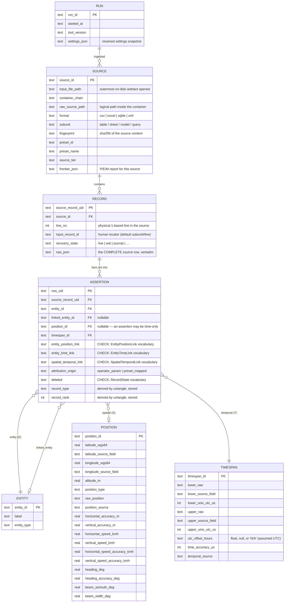
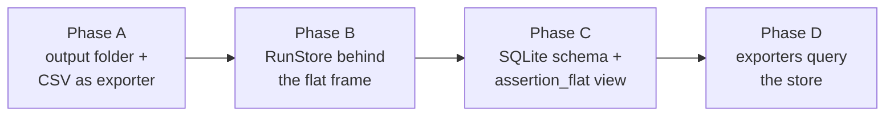

# Relational core model

Purpose: define the relational model that replaces the flat 45-column frame as the
centre of mATLAS, and the migration path to it. The entity–space–time triangle is
reified as an **assertion** table; every output — including the current flat CSV —
becomes a projection (a query) over one run store.

Related docs: [integration_model.md](integration_model.md) (the column families and
their meaning, unchanged), [architecture.md](architecture.md) (pipeline stages),
[traceability.md](traceability.md) (sidecars).

## Why

The flat row is a join that has already been performed: entity ⋈ time ⋈ position ⋈
bindings ⋈ provenance, one row per assertion. Every exporter starts by partially
undoing that join. Making the relational form the centre inverts this:

- the join is defined **once** (the `assertion_flat` view); every output is a query,
  so no exporter can disagree with the CSV about what a row means;
- provenance is stored **once** per source/record instead of repeated per output row;
- the run becomes queryable (an examiner can ask questions the CSV cannot answer).

## The model

### Semantics — the decisions and why

**The assertion is the reified ternary fact.** The three link columns
(`entity_position_link`, `entity_time_link`, `spatial_temporal_link`) live on the
assertion, not on the corner tables: an entity is just an entity; *how* it binds to a
place at a time is a property of the fact. The existing controlled vocabularies
(`model_atlas.model.families` enums) become CHECK constraints.

**Corners are observations, not deduplicated values.** Each assertion owns its own
POSITION and TIMESPAN row (1:1 ownership). Two assertions whose coordinates are
identical still get two position rows, each traceable to its own record — the model
never presumes two sources observed "the same" position. Value equality remains
queryable; identity is never inferred. This ownership is literal in the schema: the
**corner PKs equal the owning row_uid** (`position_id` = `timespan_id` = `assertion.row_uid`),
so a corner row exists only when its assertion carries that corner and the view LEFT
JOINs it back on `row_uid`.

**Position↔timespan is many-to-many *through* assertions.** The corners never link
to each other directly. A 4-hour interval with several sporadic positions is N
assertions sharing the same timespan values (`spatial_temporal_link =
sporadic_during_interval`); several entities at one time is N assertions with
different `entity_id`. Every such connection therefore always carries its links,
its record, and its provenance — the point of reifying the triangle.

**One ENTITY table, two roles.** `entity` is the trace-bearing thing (MSISDN, IMEI,
device); `linked_entity` is the actor it is attributed to (the subscriber, the
owner). Example: *MSISDN A connected to an antenna at position X,Y at time T; the
subscriber of MSISDN A is person Y* → `entity` = MSISDN A, `linked_entity` = Y.
Both are rows of the same table; the assertion carries both foreign keys.

**Attribution provenance.** The entity→linked_entity attribution is itself an
assertion with its own origin: the operator (`--linked-entity`) or a preset mapping —
never the evidence itself. `attribution_origin` records which, so an examiner can
distinguish "the file said so" from "the analyst said so".

**Verbatim passthrough is per record.** `RECORD.raw_json` stores the complete source
row verbatim, once per source record (today it is repeated on every fan-out row as
`orig_<col>` columns). The `assertion_flat` view re-emits the `orig_<col>` columns
exactly as today, so forensic verification against the source is unchanged — and it
now survives even column names that collide with canonical ones.

**Untangle is computed once and stored.** `record_rank` / `record_type` are written
into the assertion table by the pipeline after all assertions are loaded. Exporters
are pure reads: the ranking is frozen in the evidential record, identical for every
projection, never recomputed at export time.

### `assertion_flat` — the canonical view

A SQL VIEW joining assertion → record → source → entity(×2) → position → timespan,
projecting today's `OUTPUT_COLUMNS` in order, followed by the `orig_<col>` columns
exploded from `RECORD.raw_json`. The current merged CSV is `SELECT * FROM
assertion_flat` plus the existing `write_csv`. **Compatibility gate: the view must
reproduce today's CSV byte-for-byte (golden pipeline tests) before anything else
migrates.**

## Physical form

- **In memory during the run**: the store is an in-memory SQLite database
  (`sqlite3.connect(":memory:")`). Exporters query it whether or not it is persisted.
- **Persisted only on request**: writing the run DB to the output folder is the job
  of the `sqlite` export (which today dumps one flat table and is superseded by
  this). Filename: `<name>.matlas.sqlite`, per the traceability-artefact naming rule.
- **Sidecars stay** — smaller and readable in a text editor:
  `<name>.matlas.traceability.json` (run summary, per-source fingerprints and
  presets) and `<name>.matlas.warnings.json` (transform warnings + the P/E/M
  frontier / model-shift report). Row-level detail lives in the model, not the
  sidecars.

## One declaration: families.py

`model_atlas/model/families.py` remains the **single declaration** of the model: the
family dataclasses, the enums, and the column type/unit metadata. A small
`model/schema.py` *derives* from it, one-directionally:

- the `CREATE TABLE` statements (column names/types from the dataclass fields),
- the CHECK constraints (from the enums),
- the `assertion_flat` view (from `OUTPUT_COLUMNS`).

No ORM, no bidirectional mapping. Adding a model column stays a one-place change,
exactly the property `OUTPUT_COLUMNS` provides today. The assembly engine emits the
typed family objects; the `RunStore` writes them.

## Outputs = projections

`--output` becomes a **folder** (with an optional base name, default derived from
the input). The exporter registry is unchanged in mechanism but the primary-CSV
special case dissolves: `csv` (the flat view) is simply the default export when none
is selected. Split mode (`--no-merge`) stops being a separate writer path — it is
the csv exporter partitioning `assertion_flat` by `preset_id`.

Each exporter is *query + serialiser*: data access is a SELECT over the store;
Python shapes the format (KML elements, the GeoVisualizer column layout). Exporters
may load a query result into pandas to shape it — the invariant is that the store is
the only data source.

## Migration plan

Each phase is independently shippable; current CLI/GUI behaviour and CSV output are
unchanged throughout, guarded by the golden pipeline tests.

- **Phase A** — pipeline writes into a folder; the merged CSV becomes the registered
  `csv` exporter; `_write_merged` / `_write_split` collapse into one exporter loop.
  No model change.
- **Phase B** — `build_rows` → `build_assertions` emitting the typed family objects
  into a `RunStore`; `store.to_flat_frame()` reproduces today's frame exactly.
  Untangle and all exporters still consume the flat frame.
- **Phase C** — `model/schema.py` generates the DDL and the view; the store becomes
  the in-memory SQLite DB; untangle writes ranks into the assertion table; the
  `sqlite` export persists the DB; sidecars slim down.
- **Phase D** — exporters migrate to querying the tables directly (GeoVisualizer's
  interval expansion becomes a natural query over TIMESPAN).

## Out of scope — deliberately

These are *analytical* layers, derivable from this schema later; baking them into
the evidential core would blur what the source said versus what the tool inferred:

- **Entity relations with validity intervals** (an MSISDN's subscriber changes over
  time). Today the operator asserts the link per run; a future `entity_relation`
  table could model it, and is explicitly not built now.
- **Place clustering / position deduplication** (shared "place" dimension).
- **Entity resolution** across sources (same person behind two identifiers).
